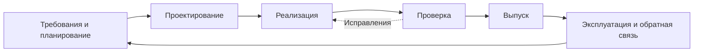

# Спецификация лекции «Использование ИИ-агентов для быстрого программирования»

Статус на 2026-11-08: обновлён первый драфт слайдов 01–10 и соответствующего сценария, расчётно на 12 минут. Есть краткое сопоставление GLM, Kimi и DeepSeek, проверенный Python-пример и автономная HTML-сборка. Первые десять слайдов переработаны по замечаниям: четыре схемы Excalidraw встроены в автономный HTML, превью проверены. Приложение, конфигурация демо, остальная теория и полная сравнительная таблица моделей ещё не подготовлены; репетиция не проводилась.

Этот файл — источник текущих требований и планов. Основания изменений находятся в [журнале решений](DECISIONS.md), дополнительные материалы — в [индексе артефактов](ARTIFACTS.md), правила работы — в [AGENTS.md](AGENTS.md). История сохранённых версий ведётся в Git; прежние архивные копии удалены по DEC-0017.

**Зафиксировано пользователем:** выступление 14 ноября 2026 года, формат и аудитория с базой Python, независимость двух блоков, приоритеты теории, OpenCode на macOS с заранее установленным ПО, функция отметки задачи выполненной, почтовый MCP, skill ревью, минимальный SDD и показ HTML в Chrome. **Предложено для обсуждения:** подробный тайминг, число слайдов и подготовленный дефект. Конкретные библиотеки Python, модель и почтовая интеграция выбираются при подготовке. HTML собирается локальным скриптом `build.py` на стандартной библиотеке Python. Возможности инструментов, тарифы и команды считаются подтверждёнными только после соответствующей проверки.

## Длительность

**Дата выступления: 14 ноября 2026 года.**

Занятие рассчитано на **80 минут: 40 минут теории и 40 минут демонстраций лектора с пояснениями**. Самостоятельной работы студентов во время занятия нет. Вопросы и обсуждение входят в эти 80 минут; подробный тайминг ниже пока предложен для обсуждения.

Первая часть проводится как показ презентации по теории. Вторая часть — демонстрация работы инструмента с китайскими моделями. Материалы второй части содержат полный набор команд и пошаговые инструкции, чтобы слушатель мог самостоятельно выполнить настройку и повторить показ после лекции.

## Аудитория

**50 человек**, студенты 2–5 курсов с разным опытом программирования. Специальные знания об LLM и агентах не требуются. Основные понятия объясняются на доступных примерах; углублённые детали помещаются в заметки лектора.

Студентам знаком Python; учебное приложение и основные примеры кода готовятся на Python. Студенты умеют писать простые программы и знают о Git; уверенное владение всеми командами Git не предполагается. Многие используют Windows или macOS, почти никто не работал с Linux. Инструкции самостоятельной настройки ориентируются на Windows и macOS; необходимые действия в терминале объясняются. Опыт Linux не является предварительным условием.

## Учебные результаты

После теоретического блока слушатель должен понимать общий рабочий процесс и иметь материалы для первого запуска. За 40 минут даются основные понятия и ориентиры; самостоятельное владение всеми механизмами не считается достигнутым только за счёт просмотра лекции.

### Инженерная база и устройство ИИ

- Понимать, зачем нужны программирование, чтение кода, тестирование и отладка: без них сложно критически оценить работу агента. Разобрать последствия слепого делегирования: незамеченные ошибки, уязвимости, неверные требования, лишние зависимости, сложность сопровождения, стоимость переделки и зависимость от подсказок агента.
- Объяснить SDLC (Software Development Life Cycle), жизненный цикл разработки программного обеспечения: от требований до эксплуатации и последующих изменений. Показать, что написание кода занимает лишь часть этого цикла; агент помогает на разных этапах, а ответственность за требования и приёмку сохраняется у команды.
- Представить SDLC как распространённую основу организации разработки, в том числе в средних и крупных ИТ-компаниях. Не утверждать, что все компании используют одинаковый процесс: названия, порядок и совмещение этапов различаются. Основание и границы обобщения зафиксированы в [источниках](sources/README.md#sdlc).
- Кратко объяснить ИИ в контексте лекции: обученная языковая модель, обработка контекста и генерация ответа; отличать обучение от использования модели. Не выдавать вероятностный ответ за гарантированное знание и не сводить весь ИИ только к языковым моделям.
- Объяснить отличие режимов по управлению последовательностью работы: человек задаёт следующие шаги ассистенту, а агент сам выбирает действия и продолжает цикл в заданных границах. Инструменты возможны в обоих режимах; один продукт может поддерживать оба. Упомянуть, что история диалога является источником контекста, однако доступная модели часть зависит от приложения: история может отбираться, сокращаться и сжиматься.
- Ввести **agent harness** («харнесс») как программную обвязку, которая организует работу модели в агентском цикле: передаёт контекст, обрабатывает запросы на инструменты, возвращает результаты и управляет продолжением работы. Отдельно обозначить среду исполнения и контроль разрешений: наличие harness само по себе не гарантирует изоляцию. Показать на схеме модель, управляющий цикл и инструменты; источники и границы термина — в [реестре](sources/README.md#agent-harness).

Обязательная схема SDLC для будущего слайда, ниже смысловой прототип:

Схема упрощает процесс: проверки и работа с безопасностью идут на протяжении цикла, этапы могут пересекаться. Позднее связать SDD с требованиями и проверкой в этом цикле; различить SDLC как жизненный цикл и SDD как подход к разработке от спецификации.

### Модель, провайдер и vendor lock-in

- Различать модель, провайдера и приложение для работы с агентом. Рассмотреть Claude и инструменты вокруг него, Codex и модели OpenAI, китайские модели, а также примеры моделей с открытыми весами и открытыми лицензиями.
- Получить актуальную сравнительную таблицу на дату подготовки с проверкой перед выступлением: роли компонентов, доступность, способ подключения, работа с инструментами, бесплатные квоты или цена, способы оплаты, условия лицензии и локального запуска. На слайде — компактное сравнение; подробности доступны в материалах.
- Обсудить доступность из РФ, ограничения аккаунтов и способы оплаты с опорой на конкретные продукты, провайдеров и источники. Утверждение «агрессивно банит» не считать установленной сравнительной характеристикой без данных. Возможность оплаты российской картой указывать только для проверенного провайдера; доступность одного сервиса не переносить на остальные продукты компании.
- Объяснить vendor lock-in, риски изменения условий и стоимость перехода. Вернуться к этой теме при обсуждении контекста и артефактов: сохранение требований, кода, решений и проверок облегчает миграцию, но не гарантирует одинаковое поведение другой модели.
- Обязательно рассмотреть GLM от Z.ai, Kimi от Moonshot AI и DeepSeek. Если нет возможности использовать OpenAI, рекомендовать начать эксперименты с доступной китайской моделью после проверки условий конкретного сервиса. Это практический маршрут выбора, а не утверждение о превосходстве всех китайских моделей или гарантированной бесплатности.
- Показать собственные агентские интерфейсы поставщиков, где они доступны, например Kimi Code. Предложить сравнить несколько интерфейсов на одной небольшой задаче по качеству результата, стоимости, удобству и контролю действий. Альтернативный путь: сосредоточить настройку процесса в OpenCode и подключать разные модели. Это снижает часть зависимости от поставщика, но оставляет зависимость от OpenCode, его конфигурации и совместимости моделей.

Обязательный слайд **«Честный взгляд: доступ, ограничения и оплата»**:

- Обсудить влияние санкционной ситуации, региональных правил сервисов и платёжных ограничений на выбор инструмента. Не объяснять каждую блокировку санкциями без подтверждения причины.
- Для Anthropic показать датированные официальные сведения о блокировках и правилах доступа. Массовость подтверждать отчётом компании; общую статистику не выдавать за число заблокированных пользователей из РФ или сравнительную «агрессивность».
- Для OpenAI разделить доступ к API и продуктам, включая Codex; указывать проверенные условия конкретного способа подключения.
- Привести пример изменчивости условий: по [сообщению Хабра](https://habr.com/ru/posts/1101976/) от 2026-10-31, на официальном сайте Kimi появилась оплата подписки картой «Мир»; **по проверке пользователя от 2026-11-08, сейчас она недоступна**. Не рекомендовать её как действующий способ оплаты. На слайде оставить датированное историческое сообщение издания; текущую проверку недоступности озвучить в речи лектора, сохранив её в сценарии. Различить историческое сообщение издания и текущую проверку пользователя; тариф, аккаунт и причина недоступности не установлены. Перед выступлением уточнить условия снова, не переносить их на API или всех пользователей.

Объяснить риски посредников двумя отдельными случаями:

- **Переданный аккаунт:** продавец может сохранить доступ, активные сессии или возможность восстановления. Владение паролем не доказывает исключительный контроль над аккаунтом; возможны потеря доступа и раскрытие истории.
- **Промежуточный API-сервер:** если он принимает и пересылает запросы в открытом для себя виде, оператор может читать или сохранять переданные промпты, код, ответы и результаты инструментов. Без проверенных условий неизвестно, как эти данные используются. Не утверждать, что любой сетевой транзит раскрывает содержимое защищённого соединения или что любой посредник уже злоупотребляет данными.

Показать схему «агент → посредник → провайдер» с границами доступа к данным и сопоставить её с прямым подключением. Рекомендовать собственный аккаунт и проверенный официальный адрес сервиса; политика обработки данных важна и при прямом подключении. Источники и статус проверки этого раздела находятся в [журнале источников](sources/README.md#доступ-посредники-и-агентские-интерфейсы).

### Задание, промпт и SDD

- Получить понятную формулу задания: цель + нужный контекст + ограничения + критерии готовности + способ проверки + ожидаемый результат. Добавлять примеры и уточняющие вопросы там, где они устраняют неоднозначность. «Волшебная формула» допустима как приём подачи, без обещания максимальной эффективности для любой модели.
- Уметь сформулировать ограниченную задачу агенту: что получить, что можно менять, чем подтвердить готовность и когда обратиться к человеку.
- Понимать SDD как разработку от спецификации: уточнение требований, спецификация, критерии приёмки, план, реализация и проверка соответствия. В демо использовать минимальный процесс с Markdown-файлами без обязательной установки отдельного SDD-фреймворка. Дать ссылки для дальнейшего изучения на [OpenSpec](https://openspec.dev/) и [GitHub Spec Kit](https://github.com/github/spec-kit); их установку и подробный разбор не включать в демонстрацию.

### Контекст, артефакты и AGENTS.md

- Понимать context engineering как отбор и поддержание полезной информации для работы модели: инструкции, история, файлы, результаты инструментов.
- Объяснить токен как единицу представления текста моделью. Обсудить английский как возможный способ сократить расход токенов: эффект зависит от текста и токенизатора конкретной модели, фиксированного процента экономии нет. Подготовить сравнение равнозначных русской и английской инструкций с указанием модели, метода подсчёта и даты; до измерения не приводить чисел. Экономию входного текста отличать от стоимости всей агентской сессии с ответами, инструментами и повторными попытками.
- Разобрать любопытный результат исследования [arXiv:2604.14210](https://arxiv.org/abs/2604.14210): переход на китайский не дал универсального выигрыша в агентских задачах программирования. В исследовании расход зависел от модели; у GLM-5 китайский потребовал немного меньше входных токенов. Не формулировать вывод как доказанное отсутствие статистически значимого эффекта: авторы не проводили формальный тест значимости. Это предварительное исследование с ограниченной выборкой, оно не сравнивает русский с английским. Подробности и границы вывода — в [источниках](sources/README.md#язык-и-расход-токенов).
- Объяснить сжатие контекста, возможную потерю деталей и роль сохранённых артефактов при продолжении работы или смене модели.
- Знать назначение AGENTS.md: структура проекта, рабочие команды, соглашения, правила проверки и границы действий. Отличать его от спецификации продукта и технических механизмов ограничения доступа.

### Инструменты и расширения

- Понимать метафору «инструменты — руки агента» и основные классы: чтение и поиск, изменение файлов, выполнение команд, браузер, внешние API и сервисы.
- Объяснить плагины на примере чтения почты. Использовать учебные письма, различать чтение и отправку; подключение почты не является разрешением на отправку сообщений.
- Различать инструмент, плагин, MCP, skill и хук; не представлять их как обязательные последовательные слои одного устройства во всех продуктах.
- Понимать MCP как способ подключения возможностей и данных; объяснить клиент и сервер на доступном уровне.
- Знать, когда создавать skill: повторяемый рабочий сценарий с понятными условиями, шагами и проверкой. Дать короткую инструкцию: описать назначение и условия запуска, записать шаги и ожидаемый результат, сохранить в поддерживаемом формате, применить и проверить.
- Понимать хуки как обработчики событий; показать примеры проверки перед действием, форматирования или журналирования. Объяснить их связь с permissions и реальные пределы контроля.
- Вернуться к схеме harness и показать, где подключаются инструменты и MCP, используются инструкции и skills, срабатывают разрешения и хуки. Отделить настройку готового harness, например рабочего процесса в OpenCode, от написания собственного управляющего кода.

### Безопасность и изоляция

- Знать правила обращения с персональными и конфиденциальными данными, ключами и токенами. Не передавать секреты в промпты, репозиторий и логи; подключать данные только при разрешённом использовании подходящего сервиса и необходимых правах.
- Не выдавать неограниченные права записи, доступ ко всем личным данным или production без необходимости. Разрешённая запись в выделенный учебный проект допустима; полный запрет любой записи не является целью.
- Не устанавливать непроверенные skills, MCP и плагины без изучения содержимого и происхождения. Объяснить prompt injection на коротком примере письма или инструкции расширения.
- Понимать назначение permissions, подтверждений, изоляции и запрета git push. Разобрать отдельное окружение, виртуальную машину или отдельный компьютер с минимальными доступами. Уточнить, что общие папки, ключи, сеть и учётные записи могут сохранять риски даже при наличии VM.

### Приёмка результата и первый запуск

- Уметь назвать признаки готовности: соответствие спецификации, осмысленные тесты, чтение изменений и проверка поведения. Понимать, что агентское ревью помогает, но не отменяет независимую оценку и ответственность разработчика.
- Кратко познакомиться с evals как повторяемой оценкой работы агента на наборе задач; отличать её от тестов приложения.
- Получить итоговую дорожную карту: выбрать доступную связку инструмента и модели → подготовить окружение и права → сформулировать задачу и спецификацию → предоставить контекст → выполнить → проверить → сохранить результат.
- Получить готовый стартовый промпт для ситуации «я не знаю, с чего начать». Его задача — собрать контекст по одному вопросу, сформировать небольшую спецификацию и план, затем перейти к ограниченной реализации и проверке. Текущий черновик: [стартовый промпт, версия 02](prompts/ART-0011-agent-start-v02.md). Статус проверки указан в самом артефакте.

## Практическая основа

Основной инструмент — OpenCode. Для демонстраций нужна модель китайского разработчика, доступная через бесплатный тариф с ограничениями и поддерживающая вызов инструментов в агентском режиме.

Лектор проводит демонстрацию на **macOS**. Основные команды на экране готовятся для этого окружения; инструкции для повторения после занятия охватывают macOS и Windows. Версия macOS, оболочка и версии инструментов фиксируются при подготовке и проверке демонстрации.

Конкретные модель и провайдер выбираются после проверки совместимости, доступности для участников и условий бесплатного использования. Фиксируются название модели, провайдер, версии инструментов, дата проверки, требования к регистрации и действующие ограничения: токены, запросы или другие квоты. Бесплатный режим должен позволять выполнить подготовленный пример без обязательной оплаты.

Демонстрационный проект — список задач на Python. Реализуемая функция — изменение состояния выбранной задачи на «выполнена». Обязательно задействовать подключаемые MCP, создать и применить skill, подготовить AGENTS.md учебного проекта, настроить permissions и хуки, включая запрет git push. Разработку вести по SDD; рабочая трактовка — Spec-Driven Development, от спецификации к реализации и проверке. Теоретический блок использует собственные короткие примеры и не зависит от этого проекта.

## Подача и визуал

Стиль — популярный, живой и профессиональный. Использовать понятные ситуации, вопросы аудитории и короткие демонстрации. Объяснять механику на конкретном поведении инструмента.

### Качество содержания

- Когда назначение тезиса или списка не очевидно студенту из контекста, добавлять короткое пояснение: например, "Что следует оценивать при выборе модели:".
- Перечисления в содержании слайда оформлять вертикальными списками, а не строкой через разделители. Стрелки схем обозначают связи, а компактные ссылки внизу слайда остаются отдельным служебным элементом.
- В слайдах и сценарии использовать одинаковые прямые двойные кавычки для открытия и закрытия: `"..."`.

- Исключить воду: каждый тезис, подпись и пример должны объяснять механизм, подтверждать вывод или помогать выполнить действие. Удалять общие вступления, повтор мысли другими словами, рекламные эпитеты и фразы без проверяемого содержания. Дополнительные разговорные связки лектор может добавить при выступлении.
- Использовать проверенные факты; отделять их от рекомендаций, предположений и результатов отдельного эксперимента. Для изменяемых условий указывать дату, продукт и ограничения проверки. Предпочитать первичные исследования и официальную документацию; ссылка должна подтверждать именно заявленный тезис.
- Исключить нейрослоп: шаблонные обещания, искусственный пафос, канцелярит, необъяснённый жаргон и декоративные метафоры. Сохранять ясный русский язык, точные термины и естественную устную речь.
- Ориентир качества — сильный технический доклад международной конференции: доказательные тезисы, читаемый визуал, воспроизводимые примеры и честно обозначенные ограничения. При редактуре проверять эти признаки, а не заменять их заявлением о «высоком уровне».

### Логика слайдов

Внутри каждого блока выстроить последовательное раскрытие темы. Новый слайд опирается на уже объяснённое и делает следующий шаг; исключить несвязанные вставки и скачки между темами. В сценарии для каждого перехода указать, зачем следующий слайд нужен после предыдущего. Возвращение к SDLC или vendor lock-in допустимо, когда добавляется новый вывод, а не повторяется прежнее объяснение.

Смысловая цепочка теории: инженерный цикл и ответственность → устройство ИИ и агента → выбор модели, интерфейса и поставщика → задание и SDD → контекст и артефакты → инструменты и расширения → безопасность → приёмка и итоговый маршрут. Самостоятельность двух блоков сохраняется: демонстрации начинают собственную цепочку с задачи и исходного состояния проекта.

### Ссылки на слайдах

При первом упоминании продукта, исследования или другого внешнего источника размещать внизу этого слайда подписанную кликабельную ссылку. Для продукта использовать официальный сайт или страницу продукта, для утверждения — конкретный первичный источник. Например, первое упоминание GLM сопровождается ссылкой на [Z.ai](https://z.ai/).

Каждый внешний URL появляется в презентации только один раз, при первом упоминании соответствующего продукта или источника. При дальнейшем использовании достаточно короткого названия; при необходимости дать внутреннюю отсылку к первому слайду. Новый документ о ранее названном продукте получает собственную ссылку при первом использовании. На слайдах с динамическими условиями указывать дату проверки. Полный реестр и связь «источник — тезис — слайд» хранить в [sources/README.md](sources/README.md); правило уникальности URL относится к `slides.md`, а не запрещает ссылки в сценарии и реестре.

### Повествование

Предлагаемые редакционные ориентиры в ответ на пожелание пользователя о подаче:

- Разговаривать со слушателем как с самостоятельным человеком: спокойно, конкретно и без назидания. Объяснять технические понятия через знакомые ситуации.
- Начинать объяснение с наблюдения или небольшого мысленного эксперимента: что произойдёт, если поручить агенту задачу без критериев готовности? Затем показывать механизм и практический вывод.
- Использовать короткие абзацы и ясные глаголы. Вводить термин после примера, когда слушатель уже понимает, какую проблему он обозначает.
- Добавлять мягкую иронию и самоиронию там, где они помогают запомнить мысль. Шутить над ситуацией и собственными привычками, не высмеивать неопытность студентов.
- Делать аналогии короткими и объяснять границы сравнения. Не приписывать модели человеческие намерения и не заменять техническое объяснение метафорой.
- Завершать смысловой фрагмент наблюдаемым действием: что уточнить, сохранить, ограничить или проверить. Не обещать универсальных рецептов.
- Использовать собственные примеры и формулировки; сохранять единый голос лектора в теории и пояснениях к демо. Все редакционные ориентиры подчиняются фактической точности и таймингу.

Это предложенная самостоятельная подача с общими чертами доступного научно-популярного объяснения; её применение к полному сценарию ещё предстоит оценить при подготовке и репетиции.

### Визуал

- Убирать нумерацию, если она не обозначает порядок или ссылочный идентификатор; три компонента "приложение, модель, провайдер" показывать без номеров. Дату актуальности размещать внизу слайда мелким шрифтом.

Каждый ключевой концептуальный блок сопровождается схемой, сравнением, иллюстрацией или демонстрацией. Визуал помогает понять действие или различие. Слайды содержат короткие тезисы; развёрнутые объяснения находятся в сценарии. Код и вывод терминала должны быть читаемы при показе аудитории.

Схемы, таблицы и содержательные картинки составляют основу презентации; избегать серии слайдов из одних маркированных списков. Обязательный набор: цикл SDLC, цикл работы агента, сравнительная таблица моделей, схема прямого подключения и посредника, слои vendor lock-in, контекст сессии и файлы проекта, инструменты и границы разрешений, итоговая дорожная карта. Добавить иллюстрации или аннотированные снимки интерфейсов там, где они объясняют конкретное действие. Для каждого визуала сформулировать вывод, который должен увидеть слушатель; декоративные картинки без учебной задачи исключить.

## Обязательная тема теории: vendor lock-in

Объяснить vendor lock-in как зависимость от поставщика, при которой смена модели, провайдера или агентского инструмента требует заметной переделки процесса, конфигурации или интеграций. Рассмотреть техническую зависимость, перенос данных и истории, условия доступа, квоты и стоимость перехода.

На схеме разделить слои: требования и код проекта, инструкции и skills, инструменты и MCP, агентская среда, модель и провайдер. Показать, какие артефакты сохраняются при замене одного слоя, а какие требуют адаптации и повторной проверки. Открытый протокол или возможность выбрать другую модель сами по себе не гарантируют одинаковое поведение, права доступа или качество.

Практические меры для обсуждения: хранить спецификации, код и инструкции в репозитории; версионировать конфигурацию; документировать внешние зависимости; проверять типовую задачу на альтернативном стеке; оценивать стоимость миграции. Пример для зала: «Провайдер отменил бесплатный тариф. Что в вашем проекте придётся изменить?» Тема обязательна только для теории; дополнительная миграционная демонстрация не требуется.

## Независимость двух блоков

Занятие состоит из двух самостоятельных тематических блоков по 40 минут. Каждый имеет собственные цель, введение, необходимые определения, примеры, выводы и вопросы. Блоки можно проводить отдельно, менять их порядок и дорабатывать независимо.

- **Теория: «От выбора агента до проверенного результата».** Объясняет принципы работы, выбор модели, постановку задач, контекст, инструменты, безопасность и приёмку. Использует схемы и короткие примеры, не требует проекта демонстрации. Примеры конкретных моделей вынесены в обновляемую сравнительную таблицу. Завершается дорожной картой, стартовым промптом и [личным обращением лектора](#завершение-первой-части-своя-рабочая-среда).
- **Демонстрации: «Рабочая сессия разработки в OpenCode».** Показывает завершённую задачу от исходного проекта до проверенного изменения. В начале кратко объясняются используемые инструмент, модель, задача и критерии результата. Все понятия, необходимые для понимания действия, поясняются на месте; ссылки на теоретическую часть необязательны.
- Замена модели или демонстрационного проекта не требует переписывать теорию. Изменение теоретических примеров не меняет сценарий демонстрации.
- Общие темы могут встречаться в обоих блоках: теория объясняет принцип, демонстрация показывает конкретное действие. Короткое повторное объяснение допустимо ради самостоятельности.
- Слайды остаются в одном `slides.md`, сценарий — в одном `script.md`. Внутри каждого файла выделяются два раздела с собственной вводной и итогом; номера слайдов остаются уникальными во всём документе.

## Предлагаемый план на 80 минут

Два независимых блока, общая длительность и формат согласованы. Демонстрационный проект — список задач — выбран. Перечень знаний теории зафиксирован в разделе «Учебные результаты»; подробное распределение времени и детали реализации остаются предложениями. Приоритет глубины согласован: постановка задачи, контекст, безопасность и проверка результата; обзор моделей и расширений компактный, подробности доступны в материалах. Время в каждой таблице отсчитывается от начала соответствующего блока. Основания изменений формата сохранены в [журнале решений](DECISIONS.md).

### Блок 1. От выбора агента до проверенного результата — 40 минут

Содержание опирается на перечень учебных результатов пользователя от 2026-11-04 с дополнениями от 2026-11-08. Предлагаемый тайминг требует репетиции. Это интенсивный вводный рассказ с визуалом; подробные таблицы и инструкции доступны для изучения после лекции. Короткие обращения к залу включены в интервалы, отдельного длинного обсуждения внутри этих 40 минут нет.

| Время | Тема | Содержание и визуал |
| --- | --- | --- |
| 00:00–03:00 | Инженерная ответственность | Знакомство, вопрос об опыте; схема SDLC и место программирования в цикле. Зачем понимать код и проверять результат, последствия слепого делегирования. |
| 03:00–07:00 | ИИ, чат и агент | Коротко обучение и использование LLM; контекст переписки; инструменты, управляющий цикл и harness. Схема перехода от ответа к выполнению. |
| 07:00–12:00 | Выбор модели и зависимость от поставщика | Разделить приложение, модель и провайдера; таблица с GLM, Kimi и DeepSeek, слайд «Честный взгляд», схема риска посредника. Сравнение собственных интерфейсов и OpenCode, vendor lock-in. Подробности — в материалах. |
| 12:00–18:00 | Хорошее задание и SDD | Формула промпта, неудачное и улучшенное задание; спецификация, критерии готовности, план и проверка. Вопрос залу о недостающем условии. |
| 18:00–23:00 | Контекст и инструкции проекта | История, токены и язык инструкций; ограничения вывода о китайском. Сжатие, артефакты, AGENTS.md и переносимость. Визуал: что хранится в сессии, а что остаётся в репозитории. |
| 23:00–29:00 | Инструменты, плагины, MCP, skills и хуки | Одна схема возможностей и управления, короткая ситуация с учебной почтой. Различить понятия, дать краткую последовательность создания skill. Форматы конфигурации подробно не разбирать. |
| 29:00–35:00 | Безопасность и изоляция | Данные и секреты, минимальные права, prompt injection, проверка расширений, permissions и запрет git push; изолированное окружение и его ограничения. Вопрос залу: что опасного в инструкции внутри письма? |
| 35:00–38:00 | Как принять результат | Критерии спеки, тестирование, diff, агентское ревью и кратко evals. Вернуться к необходимости инженерной базы. |
| 38:00–40:00 | Дорожная карта, стартовый промпт и личный финал | Кратко показать маршрут и ссылку на промпт «помоги начать». Завершить приглашением собрать свою рабочую среду и личным прогнозом о персонализации. Последние 45–60 секунд отвести финалу; точный темп проверить репетицией. |

Предлагаемый ориентир для теоретического блока — 20–24 основных слайда с одной мыслью или визуалом на каждом. Команды, конфигурацию и инструкции воспроизведения хранить в `examples/`; проверенные сведения о моделях и источниках — в `sources/`. В слайды и сценарий включать нужные для показа фрагменты со ссылками на полные материалы. Объём сценария и число слайдов уточнить после репетиции. Дополнения от 2026-11-08 включаются в эти же 40 минут: сократить второстепенные пояснения, вынести полные таблицы и методику исследований в материалы. Если репетиция показывает перегрузку, согласовать глубину изложения, не увеличивать длительность молча.

### Завершение первой части: своя рабочая среда

Завершить именно теоретический блок, после дорожной карты и стартового промпта. Связать уже объяснённый harness с возможностью подстроить инструменты под свои задачи. Готовый harness представить как разумный способ начать; создание собственного с нуля — как добровольный дальнейший учебный проект, позволяющий разобраться в устройстве и выбрать нужное поведение. Настройку OpenCode не называть написанием собственного harness с нуля. Демонстрационный блок сохраняет согласованный объём.

Личный прогноз лектора: продукты будут всё сильнее подстраиваться под индивидуальность человека. Пример с телефоном относится к интерфейсу и поведению программ, а не обещает автоматической перестройки аппаратных характеристик. Явно обозначить это мнение словами «я думаю» или «мне интересно такое будущее», не выдавать его за установленный факт или неизбежный сценарий. Персонализацию связать с выбором пользователя и сохранением контроля над данными и действиями.

Предлагаемая реплика для первого драфта, примерно 45–60 секунд:

> Можно взять готовый harness и начать работать. А поскольку мы учимся, я предлагаю со временем собрать свой с нуля. Начать с одной задачи, подключить нужные инструменты, задать границы и научиться проверять результат. Так можно понять, какие решения подходят именно вам.
>
> Я думаю, технологии будут всё сильнее подстраиваться под человека. Мне нравится представлять, что однажды я просто куплю телефон, а его интерфейс и программы постепенно настроятся под мои привычки и задачи. При этом я буду решать, что ему можно знать и делать.
>
> Со своей средой разработки можно экспериментировать уже сейчас. Выберите одно неудобство в своей работе и попробуйте его устранить. Это и будет ваша первая задача.

Для финального слайда предложена иллюстрация одной основы и разных настроек под людей; короткая подпись «Какую рабочую среду вы соберёте для себя?». Образ телефона остаётся в речи. Полную формулировку и визуал оценить при подготовке драфта; в финале не вводить новых технических терминов.

### Блок 2. Рабочая сессия разработки в OpenCode — 40 минут

Результат: слушатель видит полный путь от задания до проверенного изменения и понимает, как повторить показ по подготовленной инструкции. Самостоятельной работы студентов во время блока нет.

Предлагаемый тайминг пересмотрен с учётом ответов от 2026-11-08. Всё ПО устанавливается заранее; до выступления готовятся доступ к модели, минимальный каркас приложения и короткие заготовки конфигурации. На отдельном слайде показать, откуда скачать нужное ПО и где находятся инструкции установки для Windows и macOS, со ссылками по правилам презентации. Все установки и настройки сохраняются в инструкции для повторения; во время показа выполняются настройки проекта, разрешений, хуков, MCP и skill.

| Время | Этап | Действия лектора и аудитории |
| --- | --- | --- |
| 00:00–04:00 | Задача и исходное состояние | Представить OpenCode и модель, показать слайд установки со ссылками, запустить каркас списка задач на Python. Обозначить функцию «отметить выполненной». |
| 04:00–10:00 | SDD и инструкции проекта | Сохранить короткую спецификацию функции, критерии приёмки и план. Создать AGENTS.md учебного проекта; пояснить отличие требований к продукту от правил работы агента. |
| 10:00–17:00 | Permissions, хуки и подключение MCP | Настроить разрешения и хуки, подключить почтовый MCP с ограниченными правами. Показать разрешённое действие, запрос подтверждения и технический запрет git push. Письмо пока не отправлять: работа ещё не проверена. |
| 17:00–25:00 | Реализация функции | Поручить агенту изменение состояния задачи на «выполнена», рассмотреть изменения и показать поведение приложения. |
| 25:00–34:00 | Skill ревью, проверка и исправление | Создать и применить skill: ревью изменений, запуск тестов и линтеров, поиск ошибок и проблем безопасности. Показать подготовленный дефект, исправление и повторную проверку; сохранить отчёт. |
| 34:00–38:00 | Письмо «Боссу» через MCP | По проверенным результатам подготовить письмо о выполненной работе. Показать адресата и содержание, подтвердить отправку, вызвать MCP и проверить результат. Не объявлять доставку только по созданному черновику. |
| 38:00–40:00 | Артефакты и вопросы | Показать сохранённые спецификацию, конфигурацию, skill, отчёт ревью и результат отправки; ответить на вопросы. |

Согласованная функция ограничена отметкой задачи выполненной; фильтры и другие функции в объём демо не входят. Для первого драфта предложены критерии: состояние выбранной задачи меняется на «выполнена», изменение видно в интерфейсе, остальные задачи не меняются. Возможный подготовленный дефект — изменение состояния не той задачи. Конкретный дефект и детали хранения состояния уточняются при реализации примера.

Каждый обязательный механизм должен иметь наблюдаемую роль в одной рабочей задаче. Не ограничиваться показом конфигурационных файлов: продемонстрировать вызов MCP, применение skill и срабатывание ограничений. Рекомендация для текущего тайминга: дополнительные сценарии деплоя, авторизации пользователей, нескольких агентов или второго проекта обсуждать только вместе с пересмотром объёма показа.

### Проведение для аудитории из 50 человек

- Все команды выполняет лектор на одном подготовленном компьютере. Студентам не нужны ноутбуки, аккаунты, установка инструментов или настройка модели во время занятия.
- Вовлечение: короткое голосование поднятием рук, прогноз следующего действия и выбор проверки. Не проводить индивидуальную настройку или отладку компьютеров участников.
- Чередовать общий результат, схему и один крупный фрагмент кода. Увеличить шрифт терминала и редактора; не показывать несколько мелких окон одновременно. Проверить читаемость с задних рядов.
- Подготовить исходное состояние, рабочий результат и отдельный вариант с дефектом. Случайная ошибка модели не должна быть условием выполнения сценария.
- Ограничить ожидание ответа сервиса: если следующий шаг не укладывается в отведённое время, перейти к сохранённому показу или проверенному состоянию проекта и явно сообщить об этом аудитории.
- Сохранить вывод, задания, изменения и результаты проверок в `examples/`, зарегистрировать полезные материалы в индексе артефактов. Инструкции для повторения после занятия подготовить отдельно от устного показа.
- Заложить переходы и вопросы в тайминг каждого блока. Подготовить быстрые переходы к сохранённым результатам при задержках сервиса, чтобы все обязательные механизмы были показаны за 40 минут.

### Вовлечение аудитории в обеих частях

Принцип согласован: обращаться к залу и в теории, и во время демонстраций. Вопросы ниже и формулировки реплик — рабочий вариант. Использовать поднятие рук и один-два коротких ответа, без обязательного опроса каждого участника. Обычно отводить на взаимодействие 20–40 секунд внутри времени текущего блока.

| Блок и момент | Вопрос или действие | Зачем |
| --- | --- | --- |
| Теория, 00:00–03:00 | «Кто пользовался Codex или Claude? Кто поручал ИИ выполнить задачу целиком?» | Узнать опыт зала и обозначить ответственность за результат. |
| Теория, 12:00–18:00 | «Что в таком задании агенту придётся угадывать?» | Улучшить критерии готовности. |
| Теория, 29:00–35:00 | Показать учебное письмо с посторонним указанием: «Что здесь можно считать данными, а что нельзя выполнять?» | Объяснить prompt injection. |
| Демо, 00:00–04:00 | Короткая реплика о сложностях доступа, затем инструмент, модель и цель показа. | Самостоятельно ввести зрителя в рабочую сессию. |
| Демо, 04:00–10:00 | «Что нужно уточнить в задании? Как поймём, что готово?» | Получить проверяемое требование. |
| Демо, 25:00–34:00 | «Как проверить, что агент изменил нужную задачу и не затронул остальные?» | Вовлечь зал в проверку критериев спеки. |
| Демо, 34:00–38:00 | «Что из отчёта проверки можно честно написать Боссу?» | Связать приёмку с отправкой сообщения через MCP. |

Предлагаемая реплика во введении демонстрационного блока (при отдельном показе можно начать с вопроса об опыте): «Кто пользовался Codex или Claude? А кто больше времени потратил на то, чтобы получить доступ? В России знакомство с ИИ иногда начинается с отдельного квеста: “Как вообще сюда войти?” Сегодня попробуем пройти сразу к разработке — на примере OpenCode и модели китайского разработчика».

Шутка относится к сложностям доступа и настройки. Она не заменяет проверку условий конкретного сервиса. Слова «народные модели» допустимы как неформальная реплика, но на слайде нужны точные название модели, провайдер и проверенные условия бесплатного доступа. При отсутствии опыта у аудитории спокойно объяснить инструменты и продолжить; не делать знакомство с ними условием участия.

## Выходные материалы

- `slides.md` — презентация целиком в одном Markdown-файле; изображения подключаются по ID из ARTIFACTS.md, который связывает файл в `assets/` с сохранённым промптом.
- `script.md` — сценарий целиком в одном Markdown-файле, связанный с номерами и названиями слайдов. Для каждого слайда: речь лектора, действия во время показа, тайминг и переход к следующему слайду. Общая длительность — 80 минут: 40 минут теории и 40 минут демонстраций с пояснениями.
- `examples/` — все примеры с исходниками, инструкциями и ожидаемыми результатами. Здесь же хранятся резервные материалы демонстраций.
- `sources/README.md` — ссылки на источники и даты проверки изменяемых сведений.

Из `slides.md` собирается простая HTML-презентация для показа в Google Chrome 14 ноября 2026 года. Markdown остаётся исходником; HTML не редактируется как независимая версия содержания. Предусмотреть навигацию с клавиатуры, читаемые схемы и таблицы, рабочие ссылки и локальные изображения; показ слайдов не должен зависеть от сети. Результат — `lecture.html`, конвертор — `build.py`; проверенная команда приведена в [README](README.md#просмотр-и-сборка). Сборка бесплатна, без обращения к моделям, установки сторонних библиотек или загрузки ресурсов из сети. Оформление минималистичное и светлое; вспомогательные CSS, JavaScript, проверки и превью хранятся в `assets/`. Скрипт встраивает оформление, навигацию и локальные изображения в HTML; используются системные шрифты. PDF и PPTX не требуются.

В `slides.md` не должно быть HTML-вёрстки. Схемы, таблицы, изображения и смысловые акценты задаются псевдоразметкой с данными и авторскими пожеланиями; реализация оформления находится в конверторе и `assets/`. Для схем и таблиц можно выбирать нативную отрисовку или изображение по ID, сохраняя содержание. Подробный синтаксис — в [assets/README.md](assets/README.md#формат-слайдов). Генерация картинок выполняется заранее с сохранением промпта; сборка использует готовые артефакты.

HTML не содержит ссылок на локальные Markdown-документы и исходный код, включая заметки лектора. Внешние источники визуально второстепенны. Кнопки заметок и верхней подсказки нет, горячая клавиша N сохранена. Важные выводы выделяются сильнее обычного текста. Поля уменьшены умеренно, с сохранением читаемости и воздуха.

## Требования к демонстрациям

### Обязательные элементы демо

- **SDD:** минимальный процесс на Markdown-файлах: до реализации сохранить спецификацию и критерии приёмки, затем план; после реализации проверить результат по этим критериям. OpenSpec и GitHub Spec Kit дать как ссылки для дальнейшего изучения, без обязательного использования в демо.
- **AGENTS.md:** создать инструкции именно для учебного приложения в `examples/`, объяснить их назначение и область действия. Не подменять их AGENTS.md репозитория подготовки лекции.
- **MCP:** подключить почтовый инструмент и реально отправить «Боссу» письмо о выполненной работе после проверки результата. Конкретные сервер и почтовый сервис выбираются и проверяются при подготовке; подробности — в [сценарии уведомления](#почтовый-mcp-и-уведомление-о-результате).
- **Skill:** создать и применить собственный skill ревью выполненной задачи: сверка со спецификацией, чтение изменений, запуск всех предусмотренных проектом тестов и линтеров, поиск ошибок и проблем безопасности. Сохранить команды, результаты, найденные проблемы и непроверенные области. Успех проверок не выдавать за доказательство полного отсутствия багов и уязвимостей.
- **Permissions:** явно настроить все разрешения, используемые в сценарии, включая инструменты MCP; показать разрешение, запрос подтверждения и отказ. Область запретов и фактическую поддержку механизма проверить для выбранной версии OpenCode.
- **Хуки:** объяснить события и обработчики, настроить используемые в сценарии хуки и показать их срабатывание; технически запретить git push. Проверить, какой механизм обеспечивает запрет и как он сочетается с permissions.

Конфигурация, команды, инструкции, спецификация, skill и результаты проверок сохраняются вместе с примером. Названия настроек и форматы файлов приводятся только после проверки по официальной документации и фактического запуска.

### Почтовый MCP и уведомление о результате

В демонстрации агент использует MCP для отправки письма «Боссу» после завершения разработки и проверки функции. Для первого драфта письмо трактуется как отчёт о работе разработчика; отправка писем при каждом изменении состояния задачи не добавляется в приложение.

Рабочая схема первого драфта: выделенные учебные почтовые ящики под контролем лектора, вымышленные данные задачи, просмотр адресата, темы и текста перед подтверждением отправки. Реальные адреса выбираются перед настройкой интеграции, учётные данные хранятся вне репозитория. Разрешить только необходимые инструменты MCP и ограничить получателя средствами выбранной интеграции, если они это поддерживают; фактические границы контроля проверить.

Письмо содержит реализованное изменение и краткий итог ревью. Если тесты или линтеры не прошли либо остались блокирующие замечания, агент не отправляет сообщение об успешном завершении: сначала исправляет результат и повторяет проверки. Формулировка об отсутствии найденных проблем относится только к выполненным проверкам; обещание «код не содержит багов и уязвимостей» недопустимо.

Показать фактический вызов MCP, результат операции и письмо в учебном ящике получателя. Отличать создание черновика, принятие письма сервисом и получение письма. При неизвестном исходе отправки сначала проверить состояние, затем решать о повторе. Для сбоя подготовить сохранённый показ отправки и получения, явно обозначенный как запись; не имитировать успешную доставку.

### Хуки и запрет git push

В теории ввести понятие хука как обработчика, запускаемого при определённом событии, и показать его место в последовательности действий. Объяснить различие хуков агентского инструмента и Git-хуков; конкретный механизм ограничения выбрать после проверки возможностей выбранного инструмента и его версии.

В демонстрационном блоке кратко повторить необходимое определение, показать настройку и проверку запрета выполнения `git push` агентом. Текстовый запрет в инструкции не выдавать за техническую блокировку. Указать точку срабатывания, область действия и ограничения выбранного механизма; запрет должен применяться до выполнения запрещённого действия. Не считать отказ из-за сети, отсутствия remote или учётных данных доказательством работы ограничения.

Проверку проводить в отдельном учебном репозитории без отправки изменений во внешний репозиторий. Показать разрешённое действие, например просмотр статуса, и отклонение запрещённого. Сохранить конфигурацию, команды, ожидаемый результат и фактическую проверку в `examples/`. Для заявленных вариантов Windows и macOS проверить настройку либо явно указать, какая часть ещё не проверена.

Объяснение и показ включаются в существующие 40 минут соответствующего блока. Детальный тайминг пересмотреть после завершения сбора контекста.

### Воспроизводимость

Все команды из лекции должны быть выполнимы в заявленном окружении. Инструкция каждого примера содержит рабочую директорию, ОС и оболочку, версии, установку зависимостей, настройку доступа, последовательность запуска и ожидаемый результат. Заполнители, требующие ввода пользователя, объясняются явно.

Для всех заявленных ОС проверяются соответствующие команды либо предоставляется общее проверенное окружение. Проверки фиксируются с датой и результатом. Успех примера оценивается по наблюдаемому результату и проверке кода, а не по совпадению текста ответа модели.

Для недоступности сервиса или исчерпания квоты готовится резервный показ: сохранённый ход выполнения и готовый результат без секретов. Он явно обозначается как заранее подготовленный.

## Критерии готовности

Сверено с файлами репозитория 2026-11-08. Текущий HTML пересобран с четырьмя схемами Excalidraw, проверен без сети; превью обновлены. Полная лекция ещё не подготовлена к выступлению. Отметка означает выполнение именно сформулированного пункта: согласование требования, наличие черновика и проверка работающего результата учитываются отдельно. Наличие требования в спеке не закрывает приёмку соответствующего слайда или демонстрации.

### Требования и решения — готовы

- [x] Зафиксированы название и дата выступления — [14 ноября 2026 года](#длительность).
- [x] Согласованы длительность, формат и размер аудитории: 40 минут теории, 40 минут демо, 50 слушателей, без самостоятельной работы.
- [x] Уточнена [подготовка аудитории](#аудитория): Python, знакомство с Git, Windows и macOS, отсутствие опыта Linux.
- [x] Согласованы [независимость блоков](#независимость-двух-блоков), учебные результаты и приоритеты глубины изложения в [плане](#предлагаемый-план-на-80-минут).
- [x] Выбраны OpenCode и macOS для демонстрации; повторение предусмотрено для Windows и macOS.
- [x] Определены Python и функция приложения: отметить выбранную задачу выполненной. Фильтры исключены из объёма; подробности — в [практической основе](#практическая-основа).
- [x] Согласованы [роли MCP и skill](#обязательные-элементы-демо): почтовое уведомление после приёмки и ревью с тестами, линтерами и проверкой безопасности.
- [x] Выбран минимальный SDD с Markdown-файлами; OpenSpec и Spec Kit включаются как ссылки для изучения.
- [x] Согласованы предварительная установка ПО и слайд с источниками скачивания и инструкциями установки.
- [x] Зафиксированы [требования к содержанию, связности, ссылкам и визуалу](#подача-и-визуал).
- [x] Выбран [формат результата](#выходные-материалы): единые `slides.md` и `script.md`, HTML-презентация для Chrome.

### Подготовительные материалы — готовы в указанном объёме

- [x] Составлены [предварительные планы обоих блоков](#предлагаемый-план-на-80-минут) с суммой 40 + 40 минут. Это расчётный план, не результат репетиции.
- [x] Создан первый драфт слайдов 01–10 в [slides.md](slides.md) и соответствующая речь в [script.md](script.md): тайминг, действия, вопросы и переходы. Остальные разделы пока каркасные.
- [x] Смысловая схема SDLC перенесена на слайд 02. Визуализация Excalidraw экспортирована и проверена на слайде в Chrome; читаемость в аудитории ещё не проверена.
- [x] Собраны [источники и ограничения проверки](sources/README.md) для части теории, включая SDLC, контекст, доступ к сервисам, язык и токены, готовые решения SDD. Полной таблицы моделей и проверки перед выступлением ещё нет.
- [x] Сохранены [справочная карта тем](sources/agent-development-topic-map.md) и [стартовый промпт версии 02](prompts/ART-0011-agent-start-v02.md). Промпт остаётся непроверенным черновиком.

### Слайды и сценарий — готовы частично

Первые десять слайдов занимают расчётные 12 минут. Слайд 10 пока завершает обзор семейств моделей; посредники и vendor lock-in остаются в продолжении. Подробный план выше предварительный: при полном драфте нужно перераспределить время тем и сохранить предел 40 минут теории.

- [ ] Подготовлена целостная презентация с визуальными объяснениями по требованиям к содержанию, логике и визуалу.
- [ ] Все [учебные результаты](#учебные-результаты) раскрыты в слайдах и сценарии, включая инженерную базу, LLM и агента, задание и SDD, контекст, инструменты, безопасность и приёмку.
- [x] SDLC показан циклической схемой Excalidraw на слайде 02; SVG и превью проверены.
- [ ] Различены SDLC и SDD при введении SDD.
- [x] Harness объяснён через состав системы на слайде 07; агентский цикл вынесен на слайд 06. Различены настройка готовой среды и создание собственной обвязки.
- [x] Подготовлен слайд 09 «Честный взгляд на доступ»; различены новости, официальные условия и проверка лектора.
- [ ] Подготовлена схема рисков посредников.
- [ ] Vendor lock-in раскрыт через слои зависимости, стоимость перехода и сохранение переносимости.
- [ ] Подготовлена полная датированная таблица моделей и провайдеров; подтверждены доступность, квоты, способы оплаты и лицензии. На слайде 10 пока только семейства моделей, поставщики и варианты подключения.
- [ ] Язык и расход токенов объяснены без универсальных обещаний; сравнение русского и английского измерено, ограничения исследования китайского указаны.
- [ ] Внешние ссылки размещены внизу слайдов при первом упоминании; URL не повторяются, реестр источников связан с номерами слайдов. Для слайдов 01–10 выполнено; полный набор ещё не готов.
- [ ] Подготовлен слайд со ссылками на скачивание и установку ПО для Windows и macOS.
- [ ] Каждый содержательный слайд имеет соответствующий фрагмент сценария с таймингом, действиями и переходом.
- [ ] Каждый блок можно провести отдельно: введение, определения, примеры, выводы и вопросы достаточны без другого блока.
- [ ] Дорожная карта и стартовый промпт включены в завершение теории; промпт проверен на выбранной модели.
- [ ] Личный финал первой части связывает свой harness и персонализацию; прогноз обозначен мнением, заключение укладывается в 40 минут теории.

### Демонстрация — предстоит реализовать и проверить

- [ ] Выбраны модель и провайдер; проверены бесплатная квота на полный пример и работа в OpenCode.
- [ ] Зафиксированы версии инструментов, ОС и оболочек; проверены окружения демонстрации и повторения.
- [ ] Функция списка задач разработана по SDD: сохранены спецификация, план и результаты приёмки.
- [ ] AGENTS.md учебного проекта создан и объяснён; это отдельный файл от инструкций подготовки лекции.
- [ ] Skill ревью создан и применён: сохранены результаты всех предусмотренных тестов и линтеров, замечания по коду и безопасности, ограничения проверки.
- [ ] Почтовый MCP отправляет проверенное письмо «Боссу» после приёмки; результат наблюдаем, повторный запуск не вызывает незаметной повторной отправки.
- [ ] Настроены permissions и хуки; показаны разрешение, подтверждение и отказ, описаны границы контроля.
- [ ] Запрет `git push` технически настроен и проверен до выполнения команды; отказ из-за сети или отсутствия remote не засчитывается.
- [ ] Подготовлены инструкции для Windows и macOS без требования опыта Linux; все приведённые команды проверены, сквозной пример воспроизводится.
- [ ] Подготовлены проверенные состояния проекта, вариант с дефектом и резервный показ для каждого этапа демо.

### Сборка и финальная приёмка — готовы частично

- [x] Текущий драфт HTML из 10 слайдов собран и проверен в Chrome без сети: навигация, заметки, четыре встроенные схемы и таблицы работают. Превью и отчёт в `assets/preview/` обновлены и просмотрены. 18 тестов конвертора прошли.
- [ ] Полная презентация собрана и повторно проверена в Chrome, включая все добавленные схемы, таблицы, изображения и ссылки.
- [x] Команда сборки и путь к результату документированы в [README.md](README.md#просмотр-и-сборка).
- [ ] Источники, условия доступа и лимиты повторно проверены перед выступлением.
- [ ] Репетиция с переходами и вопросами укладывается в 80 минут с разделением 40 + 40.
- [ ] Терминал, код, схемы и текст читаемы с задних рядов аудитории.

## Замечания к первому драфту — выполнены

Визуальный образец Excalidraw одобрен пользователем (DEC-0029). Первые десять слайдов и сценарий переработаны вместе; расчётный тайминг сохранён: 12 минут. Пользователь выполнил экспорт и браузерную проверку после тайм-аутов согласования доступа в агентской среде. Отчёты подтверждают работу без сети, загрузку изображений, отсутствие ошибок и выходов за границы, навигацию и клавишу N. Агент просмотрел все десять PNG. Проверены заголовки, интервалы, локальные ссылки и отсутствие привязки теории к приложению демо.

- [x] Пример "Завершилась другая задача" перенесён в каркас практического блока. Инженерная база раскрывается в теории через требования и проверку результата.
- [x] Подготовлены смысловые данные, задания и шаблоны Excalidraw для SDLC, LLM и harness. SVG и редактируемые сцены получены; подписи внутри узлов, стрелки привязаны к ним.
- [x] SVG и редактируемые сцены трёх новых диаграмм получены и визуально проверены.
- [x] Агентский цикл получил отдельный слайд 06 с одобренной схемой ART-0018. Перечень "Примеры действий агента" удалён; состав системы отделён от последовательности работы.
- [x] Критерии выбора модели и агентского режима объединены в один вертикальный список. Акценты заданы на всю ширину содержательной области.
- [x] Обзор AWS о LLM заменён авторским учебным разбором 3Blue1Brown. Ссылка OpenCode ведёт на официальный сайт.
- [x] Уточнена историческая формулировка про оплату Kimi картами "Мир"; текущая проверка остаётся в сценарии.
- [x] Обновлённый HTML проверен без сети; превью и отчёт соответствуют текущим слайдам.

Исследование D2 + ELK остаётся [историческим сравнением](sources/diagram-engine-selection.md), а не текущим выбором движка.

## Открытые вопросы

### Решения с участием лектора

- Для первого драфта обязательных вопросов к лектору не осталось.
- До фактической настройки почты: учебный аккаунт отправителя и адрес получателя «Босс». Для драфта использовать обозначения без реальных адресов и секретов.
- После репетиции: подробный тайминг в пределах 40 + 40 минут; приоритеты глубины уже согласованы.

### Проверки при подготовке

- Зафиксировать версию macOS, оболочку лектора и версии инструментов; выбрать и проверить вариант запуска для Windows.
- Выбрать модель и провайдера, проверить бесплатный агентский режим и квоты на полный пример.
- Подготовить актуальную таблицу моделей с первичными источниками; отдельно проверить способы оплаты, доступность из РФ и лицензии. Оплату Kimi картой «Мир» не считать доступной: пользователь сообщил о недоступности 2026-11-08. Перед выступлением повторно проверить официальный интерфейс или справку и точный продукт; историю изменения сохранить в источниках.
- Измерить расход токенов равнозначных русской и английской инструкций для выбранной модели; сохранить тексты, метод подсчёта и результат.
- Выбрать библиотеки Python и проверяемые критерии функции, подготовить тесты и линтеры.
- Выбрать почтовый MCP, проверить минимальные права, подтверждение отправки, защиту от повторного письма и наблюдаемое получение.
- Проверить skill ревью, permissions и хуки выбранной версии OpenCode, включая технический запрет git push и его границы.
- После наполнения всей лекции повторить проверку HTML: навигация, заметки, схемы, ссылки и автономный показ в Chrome.
- Протестировать стартовый промпт и все команды; собрать резервные состояния и провести репетицию.

## Точка продолжения

Первый драфт слайдов 01–10 и замечания к нему завершены в указанном выше объёме. Следующий фрагмент теории: посредники, vendor lock-in, постановка задачи и SDD; затем остальные темы по плану. Пример ошибки ID сохранён в практическом каркасе и `examples/01-task-id/`. Полные 40 минут теории и 40 минут демо ещё предстоит подготовить.

Сборка — по README; экспорт схем и обновление превью — по `assets/README.md` и `assets/excalidraw/README.md`. Нерепетиционный тайминг первого фрагмента — 12 минут. Не включать посторонний каталог `chrome/` в изменения лекции. Для начала следующей сессии прочитать AGENTS.md и эту спецификацию.

### Последнее уточнение перед коммитом

Слайд 05 и сценарий уточнены по замечанию пользователя: сравнивается управление последовательностью шагов, а не отсутствие или наличие инструментов. Инструменты доступны и ассистентам; пояснение размещено под сравнением. После этой правки превью обновлены; все десять слайдов повторно проверены в Chrome без сети. Слайд 05 просмотрен: пояснение и смысловой акцент помещаются в кадр.
